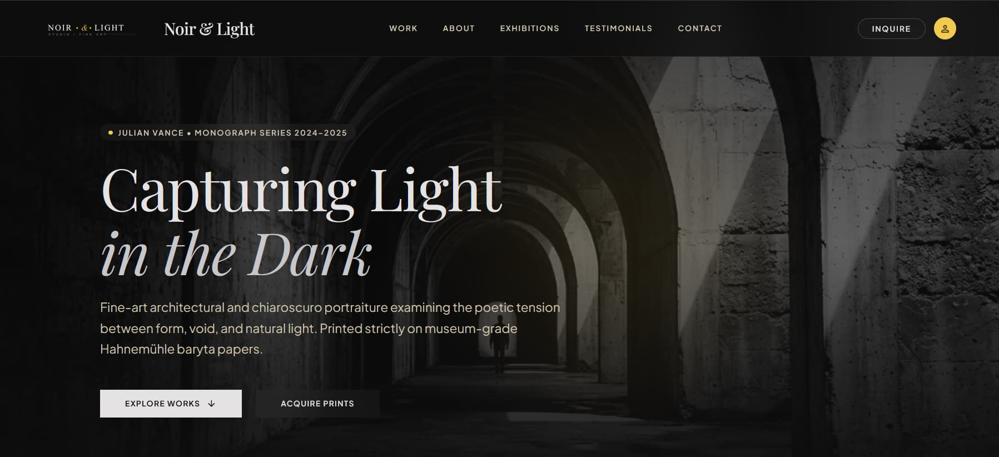
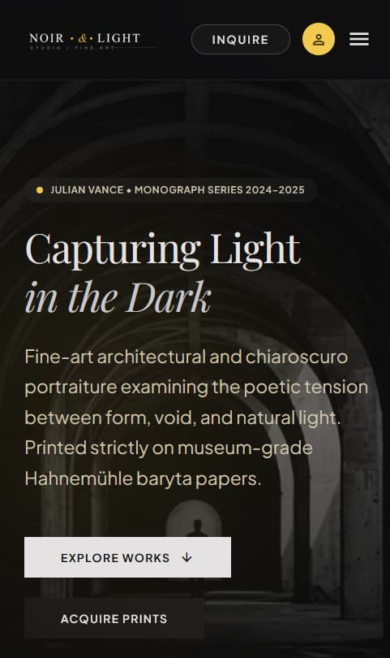

# Noir & Light Studio

A responsive portfolio website for a fictional fine-art photography studio, built to practise turning a UI design into a production-ready React site.

**Live site:** [noir-and-light.vercel.app](https://noir-and-light.vercel.app)





> **Demo project.** The studio, artist, artworks and testimonials are all fictional.

## Features

- Responsive layout tested on phone, tablet, laptop and large screens
- Frosted-glass (glassmorphism) navigation bar over full-bleed hero imagery, with a mobile menu
- Scroll-aware navigation that highlights the section currently in view
- Filterable "Selected Works" gallery with an asymmetric editorial grid
- About section, frosted-glass testimonial cards, inquiry form and newsletter box (controlled React inputs, built-in validation, success states)
- Design tokens (colors, type scale, spacing) copied exactly from the original design into the Tailwind config
- Optimised images and share-preview metadata (Open Graph) for clean link previews

## Built with

- [React](https://react.dev/) + [Vite](https://vite.dev/)
- [Tailwind CSS](https://tailwindcss.com/) v3
- Google Fonts: Playfair Display and Plus Jakarta Sans
- Deployed on [Vercel](https://vercel.com/)

## Process

The visual direction and prompts were mine; the first design draft was generated in Google Stitch. I then rebuilt it by hand, one component at a time, with Claude as a step-by-step guide: porting the design tokens, adding the missing mobile navigation, fixing tablet and phone layouts, and wiring up the interactive parts (gallery filters, scroll-aware nav, forms).

## Run locally

```bash
git clone https://github.com/Keonii01/noir-and-light.git
cd noir-and-light
npm install
npm run dev
```

Build for production with `npm run build`, and preview that build with `npm run preview`.

## Project structure

```
src/
  components/   Navbar, Hero, SelectedWorks, WorkCard, About,
                Testimonials, Contact, Footer
  data/         works.js  (artwork details and filter names)
public/
  images/       hero, artwork and portrait images, logo
```

## Known limitations and next steps

- The inquiry and newsletter forms are front-end only. They validate and show a confirmation, but nothing is sent yet.
- Footer links are placeholders.
- The Exhibitions navigation item is intentionally inactive, since the design has no matching section.

## Author

Dami ([@Keonii01](https://github.com/Keonii01))
